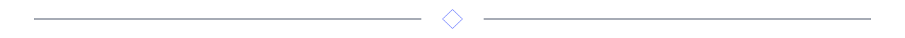
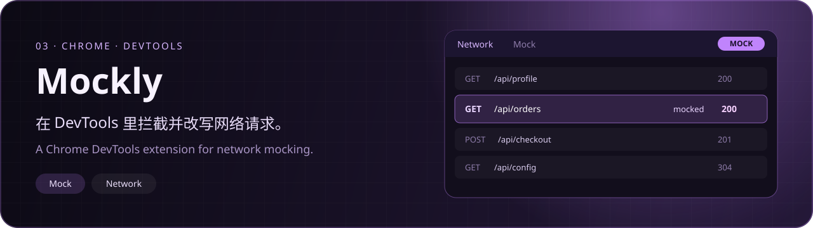
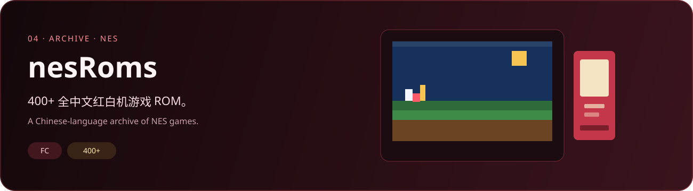
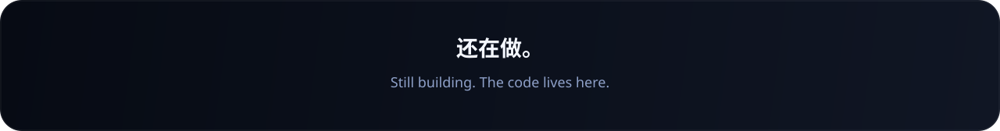

  

  
  &nbsp;
  

  

  

  

  
  &nbsp;
  

  

  <a href="https://github.com/tomiaa12/eruda-cn">eruda-cn</a>
  ·
  <a href="https://github.com/tomiaa12/live2djs">live2djs</a>
  ·
  <a href="https://github.com/tomiaa12/spacingjs">spacingjs</a>
  ·
  <a href="https://github.com/tomiaa12/monitor.js">monitor.js</a>
  ·
  <a href="https://github.com/tomiaa12/w2chii">w2chii</a>

