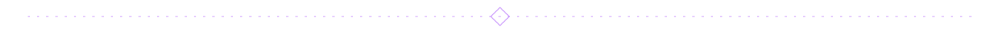

<b>桌面应用、浏览器工具和笔记，都放在公开的地方。</b> 
<b>Desktop apps, browser tools, and notes, kept in public.</b>

  

## Multara

<b>一个窗口，放下所有 AI 编程智能体。</b>Claude Code、Codex、Cursor 共用同一份本地目录、任务和编辑器。 
<b>One window for Claude Code, Codex, and Cursor.</b> They share the same local folders, tasks, and editor.

## Quka

<b>双击 Ctrl 或 Command，打开本机应用。</b>搜索并打开已经装在 Windows 或 macOS 上的应用。 
<b>Double-tap Ctrl or Command to open an installed app.</b> Find an app that is already installed, then open it.

## Mockly

<b>在 DevTools 里拦截并改写网络请求。</b>在面板里把某一条请求换成你写好的响应。 
<b>Intercept and rewrite network requests in Chrome DevTools.</b> Swap one request for a response you wrote.

## nesRoms

<b>400+ 全中文红白机游戏 ROM。</b>红白机、FC，游戏 ROM 放在一个仓库里。 
<b>A Chinese-language archive of NES games.</b> NES and Famicom ROMs, collected in one repository.

## KYX Box

<b>技术笔记写在 kuangyx.cn。</b>做过的东西，写在这个站上。 
<b>Notes published at kuangyx.cn.</b> What shipped is written down on that site.

  <a href="https://github.com/tomiaa12/eruda-cn">eruda-cn</a>
  ·
  <a href="https://github.com/tomiaa12/live2djs">live2djs</a>
  ·
  <a href="https://github.com/tomiaa12/spacingjs">spacingjs</a>
  ·
  <a href="https://github.com/tomiaa12/monitor.js">monitor.js</a>
  ·
  <a href="https://github.com/tomiaa12/w2chii">w2chii</a>

